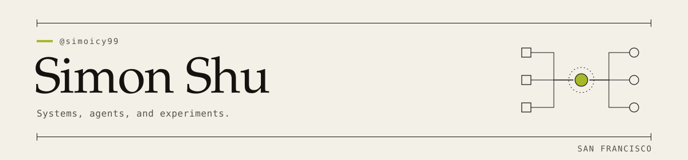

<picture>
  <source media="(prefers-color-scheme: dark)" srcset="assets/identity-dark.svg">
  
</picture>

# Simon Shu

Co-founder at [Restart](https://restart.new). San Francisco.

Previously Tesla Optimus, Scale AI, and Conduit Intelligence.

## Selected systems

A few public systems and prototypes, with the implementation behind each.

**[Dureg](https://github.com/simoicy99/dureg)** · Prototype

Surveillance for prediction-market exchanges. Deterministic detectors feed contextual agent triage, with orchestration, run traces, and a human disposition workflow.
[Detectors](https://github.com/simoicy99/dureg/blob/main/src/lib/agents/detectors/registry.ts) · [Agent triage](https://github.com/simoicy99/dureg/blob/main/src/lib/agents/surveillance.ts) · [Audit log](https://github.com/simoicy99/dureg/blob/main/supabase/migrations/0002_audit_revoke_writes.sql)

**[Luma Autopilot](https://github.com/simoicy99/luma-autopilot)** · MIT-licensed tool

Browser automation for discovering and registering for free events, with a review runbook and an explicit NEEDS-HUMAN path for unanswered required questions.
[Classifier](https://github.com/simoicy99/luma-autopilot/blob/main/browser/pipeline.js) · [Runbook](https://github.com/simoicy99/luma-autopilot/blob/main/.claude/skills/luma-autopilot/SKILL.md)

**[Ignite](https://github.com/simoicy99/IGNITE)** · Experimental MVP

A competitive-gaming MVP exploring wallet transfers, match settlement, and disputes through Prisma transactions and idempotency keys. Payment and verification flows include test adapters and stubs.
[Ledger](https://github.com/simoicy99/IGNITE/blob/main/packages/ledger/src/index.ts) · [Disputes](https://github.com/simoicy99/IGNITE/blob/main/services/api/src/routes/disputes.ts)

For the design questions behind these, read the [engineering map](docs/engineering-map.md).

Earlier: [Livva](https://github.com/simoicy99/livvarentalai), a rental platform prototype. For fun: [sam.events](https://sam.events).

## Elsewhere

[Website](https://simonshu.com) · [X](https://x.com/SimonLivva) · [LinkedIn](https://www.linkedin.com/in/yuchengshu)
